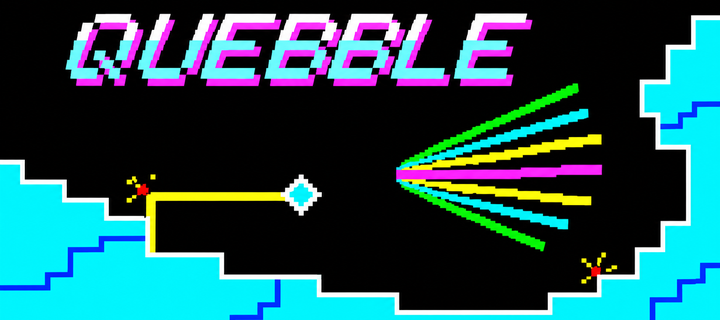

# Quebble

Quebble is a native C territory-capture arcade game for Pebble Time 2 (emery).



Source code for the 1.7.0 watchapp, with native game logic, host regressions,
bundled offline audio and publishing artwork. The app targets emery only.
Reference PDFs, example projects, build output and local recordings are not
included in this repository.

Installable PBW files and the publishing kit are available from
[GitHub Releases](https://github.com/landostock/quebble/releases).

The watchapp is built around a fixed byte grid, queue-based flood fill from the
enemy region, touch swipe steering, and full button fallback. It is deliberately
small enough for the Pebble memory budget while still including score, lives,
high score persistence, edge runners, an animated interior enemy, fuse pressure,
slow/fast claiming, vibration, and backlight feedback.

New lines can reconnect to the exposed edge of already claimed territory, not
only to the outer border. Old line borders remain visible. The interior enemy is
a seven-line history of a moving straight segment. Position, angle, length and
speed have independent random envelopes. On aggressive stages a new heading
occasionally receives a bounded player bias; it is never continuously homing.
The 64-by-60 arena uses three-pixel
cells, a two-row HUD, larger markers and saturated colours for watch readability.
The compact HUD groups claim/target and score above lives, level and a threat
clock. The clock icon follows the measured text width, keeping a four-pixel gap
even as the number changes. Cyan, yellow and red separate the groups; slow/stopped status replaces
the level while relevant, and the multiplier appears only above one.
Separate smoothly changing intensity
envelopes control translation and rotation: small changes are common, large
swings intermittent. A narrow bundle can travel quickly while a broad fan can
turn locally. Length targets span 18-64 pixels independently of those envelopes.
A moving pivot near either endpoint creates asymmetric fans rather than
a continuously spinning symmetric propeller. Combined steps fit the endpoint budget
instead of cancelling the turn. Rendering and collision use the same
two-pixel stroke footprint; each endpoint moves at most four pixels per axis per tick.
Rejected poses cannot enter walls, and the full swept segment detects trails.
The edge runners can follow new territory contours or pass their junctions,
with a seeded preference for continuing straight, not mandatory turning. This is
an inferred routing model, not a claim about the reference game's original code.
Movement speed stays constant (including their super state). Pixel-interpolated
movement advances at most one pixel per tick; rendering and contact tests use
that same interpolated center. Their original procedural sparks form three short,
asymmetric stepped curls with open gaps, not a solid four-arm star. Whole yellow/red
pixel blocks change together, switching to cyan/blue in their super state; the
field border remains visible through the open center. Every body element uses a two-by-two-pixel
brush shared by drawing and collision, with no single-pixel tendrils.
Eight independently deforming body phases
have unequal dwell times over 19 ticks. No background rectangle erases the
border or territory underneath them, and no reference sprites are included.
A four-pixel playfield inset keeps the entire effect
visible on all four edges and below the HUD. Sprite pixels also determine contact
with the marker. A short countdown starts each level; a successful claim pauses
briefly for visual confirmation.

When a claim buries the marker's old boundary, a queue-based search places it on
the nearest reachable exposed frontier. Hidden old borders stay visible but are
not ordinary movement paths. Post-claim continuation stays on a safe frontier.

The original Quebble pixel wordmark assembles from individual tiles. Countdown
digits, HIT, CLEAR and GAME OVER share the tile-assembly style. All in-game
text is English, with a separate controls screen and touch-friendly menu actions.
The backlight stays on throughout a round, including countdowns and claim/death
pauses and the results screen. The final hit finishes before results appear;
results remain visible until Retry or Menu. Title/help, focus loss and app exit
release the backlight to system control.
Keeping the backlight on consumes more battery.

## Audio And Haptics

Version 1.3 uses an offline, bright 11.294-second chiptune loop and short event
effects for the Time 2 speaker. Music is Juhani Junkala's "Title Screen" from
[5 Chiptunes (Action)](https://opengameart.org/content/5-chiptunes-action),
with bass attenuation and presence EQ for the small speaker.
Effects are adapted from Kenney's
[Digital SFX Set](https://opengameart.org/content/63-digital-sound-effects-lasers-phasers-space-etc).
Both collections are CC0. Credits, source URLs and adaptation notes are included
in the PBW and the Audio credits screen. Nothing is downloaded at runtime.

On the title, Down opens Sound. Up/Down choose a row; Select toggles Music,
Effects or Haptics, cycles Volume, or opens Audio credits. Touch rows work too.
Settings persist between launches. The default volume for new installs is 50%;
Volume cycles through 0/25/50/75/100%. Existing saved settings are retained.
Music is mixed
below effects and ducked during cues. The system's speaker mute and Quiet Time
are respected. No microphone is used. Menus are quiet; gameplay has music, and
death/clear/results use short cues instead. Background music pauses for those
transitions and resumes without restarting the song on every life.

The native integer mixer reads 256-sample chunks from resources, not a whole
song into RAM. It handles partial speaker writes without sleeping or blocking
game input. Stream restarts wait for the old asynchronous completion callback.
All PCM is now signed 16-bit little-endian at 8 kHz. This preserves the chiptune
timbre without the coarse 8-bit quantization of quiet effect tails. Effects have
longer fades and silent handles. Once audio starts, the stream stays open across
countdown, play, capture, hit and level-clear states, feeding silence between
cues rather than repeatedly switching the speaker off and on. After returning
to a menu or results, at least 128 ms of silence precedes a normal stream close.
If both Music and Effects are disabled, the stream is released even mid-round.
Focus loss and exit stop playback; preemption by system audio is not fought.
Single vibration pulses mark countdown (10 ms), start (28 ms), claim (32 ms),
hit (110 ms) and clear (65 ms). Game-over does not repeat the final hit buzz;
steering, stop/go and warning cues do not vibrate. Continuous audio,
like continuous backlighting, increases battery consumption.

## Controls

- Buttons: Up turns left and Down turns right relative to the marker's current
  heading, always exactly 90 degrees, even if the new direction is blocked.
  Valid turns start movement; blocked turns update the heading and stop.
  Turning into free space starts a cut without a long press.
- Select while moving: stop. When stopped: go straight; free black space inside
  the frame starts a new cut. If forward is blocked, try the opposite direction.
  Outside the frame and buried interiors are blocked; unfinished lines cannot
  be reversed or crossed, so if both directions are illegal the marker stays still.
- Button movement keeps heading through junctions. All bends with one onward
  safe path turn automatically, including captured-area corners. Multiple turns
  without a straight path stop for a choice. Coasting never starts a cut.
- Hold Up/Down: the same relative turn, also selecting Slow for the next cut.
- Hold Select: choose Slow/Fast for the next cut (a cut keeps its starting speed).
- Back: return to the start/control screen.
- Hold Back: exit.
- Swipe up/right/down/left: move in that screen direction. A short, clear flick
  is enough; one direction is committed as soon as the native pan recognizer
  starts. A swipe into free space starts a cut. Return swipes are ignored:
  use tap on safe paths. Liftoff cannot turn again or stop.
- Touch movement is unchanged: safe paths follow a sole onward road, including
  internal corners, and wait at forks. Tap reverses on a safe path; while drawing,
  tap stops/resumes without reversing. The last accepted steering or stop command
  selects its button/touch movement rules, which persist across lives and levels.
- Title: Select opens difficulty selection; Up opens Guide, Down opens Sound.
- Guide: three concise pages cover the goal, touch and relative buttons. Touch
  is recommended because swipes choose screen directions directly. Select
  advances, then opens difficulty selection from the final page. Up/Down select
  the previous/next page; left/up swipes advance, right/down swipes go back.
- Difficulty: Up/Down choose, Select starts. Tapping a mode selects and starts it.
- Title footer: tap its left/right side for Guide/Sound.
- Results: Select or tap Retry to restart; Back or tap Menu to return to the title.

The watch-wide volume is under Settings > Sounds & Haptics > Volume, alongside
Mute Speaker (the parent menu can be called Vibrations on older firmware).
App volume does not override the system volume, mute or Quiet Time.

Version 1.6 keeps relative buttons while making all quarter turns selectable,
even through blocked intermediate headings. For example, arriving westbound at the
left wall, Up turns south and Down turns north. These are relative left/right
turns, not absolute north/south buttons. No direction arrow or heading tip is drawn.
Touch retains the separate actual arrival direction, absolute swipes and tap-to-
return rules. Version 1.7 removes all in-game direction arrows, including touch
fork hints in the field and HUD, without changing steering or junction rules.

## Difficulty And Edge Movement

| Mode | Lives | Claim goal | Pressure interval | Second interior enemy | Four edge enemies | Starts with super enemies |
| --- | --- | --- | --- | --- | --- | --- |
| Easy | 4 | 65% | 45 s | Level 5 | Level 7 | Level 9 |
| Standard | 3 | 75% | 30 s | Level 3 | Level 5 | Level 7 |
| Expert | 2 | 80% | 22 s | Level 1 | Level 3 | Level 5 |

Pressure intervals release another pair of edge enemies, then enable their
ability to enter unfinished trails. Their movement speed never increases.
Fuse grace periods are 33/21/15 ticks respectively. Player speed is the same
in all three modes; best scores are stored separately. Existing best scores
belong to Standard. Mode and audio preferences persist.
Fast movement is one cell every 99 ms (previously 132 ms), Slow every 165 ms
(previously 231 ms); edge enemies remain at 198 ms. Faster player movement does
not make the enemies faster.

After a capture, the whole game freezes for one second. Button movement resumes
along a straight safe heading or the sole onward safe exit; ambiguous turns wait.
Use Up/Down to turn or Select to go straight/back. Touch follows a
sole onward safe exit and waits at forks or dead ends. Only the marker waits;
enemies and their wave timer keep running after the freeze.
Relative button turns, a resume/stop request, absolute swipes and a touch return request
can be buffered during the pause. Button turns are resolved against the heading
at input time, so an automatic corner cannot rotate the queued command again.
Invalid return swipes cannot replace an earlier valid choice.
Only still-exposed boundaries are traversable; buried historical lines remain
visible in cool cobalt blue but cannot be used as interior roads. Active line borders
stay white. This is a rendering distinction only; capture and path rules are unchanged.

Four-way junctions remain button-playable through straight travel and relative
left/right turns. Touch can choose any forward arm with an absolute swipe.

Touch uses Pebble's native horizontal/vertical pan and tap recognizers. The
pan threshold is more than 10 px with an unambiguous dominant axis; unlike the
SDK swipe recognizer, it does not require a minimum flick velocity. Native
exclusive recognition prevents a drag from also becoming a tap. Diagonal
gestures that never resolve to an axis are ignored. Buttons remain playable.

## Standard Progression

In Standard the claim target stays at 75%. The first four stages use one random interior
enemy, one aggressive enemy, two random enemies, then two aggressive enemies.
Timed pressure first adds another edge-runner pair, then enables line pursuit.
The super state must physically reach the marker; merely touching a trail is
not a remote kill. Runner speed is fixed at one cell per six ticks in every stage.

For the watch, a wave lasts 30 seconds, stages 5-6 start with four normal runners
and stage 7 onward starts with four super runners. These later thresholds and
the bounded steering bias are explicit watch balancing choices, not claims of
identical original timing or source-code reproduction. See
[reference derivation](docs/reference-derivation.md) for evidence and limits.

## Build

```bash
pebble build
pebble install --emulator emery
```

Requires a configured Pebble SDK with emery support; the release was built with
SDK 4.44. The optional isolated `HOME=/private/tmp/quebble_home` build convention
in AGENTS.md needs its own configured SDK environment first.

## Tests

The flood-fill logic is pure C and can be tested off-device:

```bash
cc -std=c99 -Wall -Wextra -DQUEBBLE_GRID_TEST -Isrc/c test/test_floodfill.c src/c/grid.c -o /private/tmp/quebble_floodfill_test
/private/tmp/quebble_floodfill_test
cc -std=c99 -Wall -Wextra -Isrc/c test/test_start_positions.c src/c/enemies.c src/c/grid.c -o /private/tmp/quebble_start_positions_test
/private/tmp/quebble_start_positions_test
```

Run all host regressions with `sh test/run_tests.sh`. This also tests 144,000
motion frames against empty/concave arenas, exact visible-pixel trail contact,
history continuity, bounded steps, non-homing random stages, aggressive-stage
bias, claimed
area connections and frozen countdown/claim states. Edge-runner tests cover
constant speed, new contours, hidden seams, trail rules and unclipped flicker.
Motion tests also cover the intensity distribution, compact/extended lengths,
fast narrow bundles and locally rotating fans. Runner regressions cover both
junction choices, staged reinforcements, all eight body phases, uniform two-pixel
colour blocks and identical coloured-render/collision masks in normal and super states.
Additional regressions reconstruct the buried-marker three-rectangle layout,
verify the thicker stroke footprint, final-hit/results/retry and menu/light
lifecycle, fixed level targets and pixel-word/digit assembly.
Hardware performance still needs testing on a physical watch.

Audio tests cover loop seams/bounds, chunk-independent mixing, ducking/fades,
partial writes, bounded queue latency, delayed completion/stop events, mute,
focus, Quiet Time, speaker unavailability and resource cleanup.

## Publishing Assets

Store images and copy are in `resources/store/` and `store/`. Eight native
200x228 emulator screenshots are in `store/gallery/`; `store/START-HERE.md`
explains the five-image upload selection and the remaining publishing checks.
Build the PBW before running `tools/package_store.py`. The artwork exporter and
package checks require Python 3 and Pillow. The core host suite runs with
`sh test/run_tests.sh` and does not require a watch or emulator.

## Rights And Notices

This public source repository does not itself grant an open-source licence for
the Quebble application or original artwork. No project-wide licence has been
selected. Third-party music and effects are CC0; the SDK-injected JavaScript
bridge retains its Apache-2.0 notice. Source attribution and licence texts are in
`resources/audio/SOURCES.md`, `resources/store/CC0-1.0.txt`,
`resources/store/Apache-2.0.txt` and `store/legal/THIRD-PARTY-NOTICES.txt`.
Publishing the source is not app-store submission or legal clearance; the
existing release checklist and risk review remain in `docs/store-readiness.md`.
